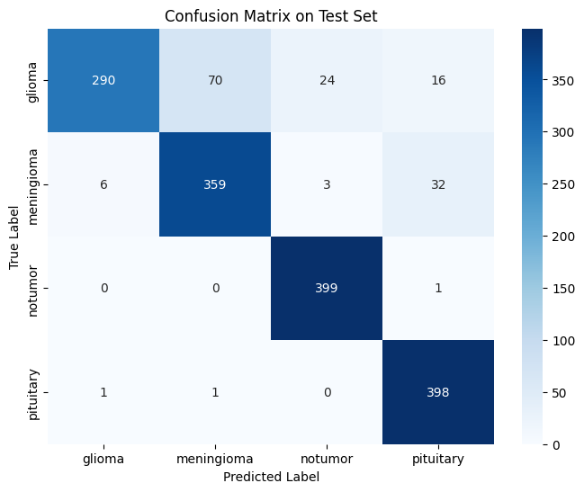
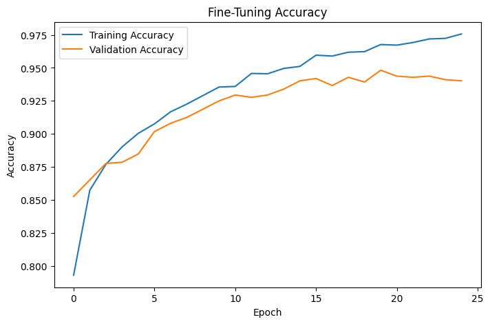
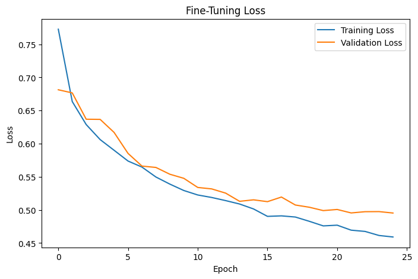

# MRI Brain Tumor Classification

This project classifies brain MRI images into four categories:

- Glioma
- Meningioma
- No Tumor
- Pituitary

The model uses Transfer Learning with MobileNetV2, followed by fine-tuning of the last 30 layers.

## Dataset

The dataset used is the [Brain Tumor MRI Dataset](https://www.kaggle.com/datasets/masoudnickparvar/brain-tumor-mri-dataset).

Download the dataset and place the `Training` and `Testing` folders inside a `data/` folder.

## Model

- Base model: MobileNetV2 pretrained on ImageNet
- Input size: 224 x 224
- Data augmentation: rotation, zoom, translation, horizontal flip, and contrast
- Feature extraction: 25 epochs
- Fine-tuning: last 30 layers, 25 epochs

## Results

| Metric | Value |
|---|---:|
| Validation Accuracy | 94.55% |
| Validation Loss | 0.4842 |
| Test Accuracy | 91.25% |
| Test Loss | 0.5776 |

## Confusion Matrix



## Training Results





## How to Run

1. Install the requirements:

```bash
pip install -r requirements.txt
```

2. Place the dataset inside a `data/` folder.

3. Run the project:

```bash
python brain_tumor_project.py
```

## Project Structure

```text
MRI-Brain-Tumor-Classification/
├── brain_tumor_project.py
├── requirements.txt
├── README.md
├── models/
└── results/
```
